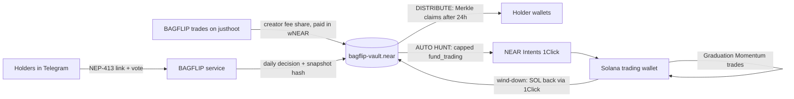

<p align="center"></p>

# BAGFLIP

**One More Flip. One More Chance.**

BAGFLIP turns a meme token's creator revenue into a community-governed treasury. Holders vote in Telegram
between distributing the rewards and deploying them through an autonomous cross-chain trading strategy.

| | |
|---|---|
| Track | **Memecoins With Mechanics** (`memecoins`); also fits **Unstoppable DeFi** (`defi`) |
| Token (NEAR, NEP-141) | [`bagflip.v2-launchpad.justhoot.near`](https://justhoot.fun/p/bagflip.v2-launchpad.justhoot.near) |
| Treasury vault (NEAR mainnet) | `bagflip-vault.near` (code hash `5HBEhQYPoyHkaBnWXDpyRTrcUnxMiCbKmd6LfBvi48D7`) |
| Live service | `https://bagflip-production.up.railway.app` (`/health`, `/public/vault`) |
| Telegram | Bot [@bagflip_bot](https://t.me/bagflip_bot) · Group [t.me/bagfliptrade](https://t.me/bagfliptrade) |
| Demo video | [x.com/bagflipmeme/status/2121600860379869318](https://x.com/bagflipmeme/status/2121600860379869318) |

## 1. Project overview

A meme token earns creator fees whenever it trades. In BAGFLIP that revenue does not go to a creator
wallet: it flows into a NEAR smart-contract vault, and holders decide what happens to it. Every day the
community chooses one of two modes:

* **💰 DISTRIBUTE**: the treasury is split pro-rata among holders, who claim from the vault.
* **🔥 AUTO HUNT**: capped amounts move to Solana through NEAR Intents, where an autonomous
  "Graduation Momentum" engine trades Pump.fun meme tokens.

The community decides **whether** to hunt. The engine decides **what, when and how** to trade, inside
limits the vault enforces.

## 2. Problem statement

* **Rewards depend on trading.** Creator fees shrink when volume fades, and holders have no lever to
  put accumulated revenue to work.
* **Holders are passive.** Beyond buy, hold and sell, meme holders rarely take part in real decisions.
* **The creator controls the revenue.** How fees are used is usually the creator's call.
* **No treasury rules.** Meme communities seldom have a structured, enforceable way to choose between
  paying out and reinvesting.

The question BAGFLIP answers: *how can creator revenue become a community-governed treasury with
enforceable rules?*

## 3. Solution

* Creator fees are routed to a **vault contract** whose only exits are Merkle-proven holder claims and
  capped, time-locked trading transfers.
* Holders link a NEAR wallet in Telegram (NEP-413 signature) and vote with buttons. **Voting power is
  their BAGFLIP balance**, read at one NEAR block for each daily decision.
* Votes are **continuous**: they stay active until changed. A decision is taken every day at 00:00
  Asia/Kuala_Lumpur and mirrored to the vault.
* A **Holder Council** of top holders, seated on chain by token balance, can veto payout lists and AUTO HUNT
  activations, or pause the vault.
* Every decision, payout list and ledger entry is published for independent verification.

## 4. Key features

| Feature | Detail |
|---|---|
| Telegram-native governance | `/connect`, one-tap DISTRIBUTE / AUTO HUNT buttons, pinned live tally |
| Token-weighted, persistent votes | Balance snapshot at one block; strict majority; ties keep the mode |
| NEAR vault with on-chain rules | No withdraw or upgrade method; 50 NEAR / 24h trading cap; 12h AUTO HUNT time lock; 24h payout veto window |
| Holder Council | Top 20 holders, seats contested on chain via `ft_balance_of`; 5 seats veto or pause |
| NEAR Intents funding | `fund_trading` wraps NEAR and deposits to a 1Click address in one atomic receipt |
| Graduation Momentum engine | Continuous discovery, explainable 0–1 score, on-chain safety checks, sell-back quote, exit ladder |
| Transparent accounting | Append-only double-entry ledger in integer units; public audit endpoints |
| Paper/live parity | Same engine trades paper fills on real Jupiter quotes; shadow books compare variants |

## 5. How BAGFLIP works



1. **Revenue.** The justhoot launchpad pays BAGFLIP's creator ("dev") fee share to `bagflip-vault.near`.
2. **Treasury.** The vault holds the funds; the service mirrors them in a double-entry ledger.
3. **Vote.** Linked holders vote; at 00:00 MYT the engine snapshots balances and decides.
4. **Act.** DISTRIBUTE publishes a payout list (claimable after a 24h veto window). AUTO HUNT waits for
   the 12h time lock, then bridges capped amounts and trades.
5. **Account.** Deposits, transfers, fills, fees and realized P&L are journaled and published.
6. **Repeat.** New fees and settled trading proceeds return to the same governance loop.

## 6. AUTO HUNT overview

Graduation Momentum targets Pump.fun tokens that have already proven demand: tokens near bonding-curve
completion and fresh PumpSwap graduates. Each scan runs discovery (PumpPortal, GeckoTerminal,
DexScreener) → hard filters → weighted score → confirmation → on-chain safety (mint/freeze authority,
risky Token-2022 extensions, holder concentration) → an executable buy-then-sell quote → sizing. That
means up to 4 positions at 25% of trading capital each. Exits use executable sell quotes: stop loss,
partial take-profit, trailing stop, crash and liquidity-collapse exits, momentum fade and a 24h maximum
hold. Full pipeline and parameters: **[docs/AUTO_HUNT.md](docs/AUTO_HUNT.md)**.

## 7. Economic model & sustainability

* **Primary revenue:** BAGFLIP's creator fee share on the justhoot launchpad. On chain, the launchpad
  reports a 5% transfer fee and a 1% pool fee for BAGFLIP, a dev share of 100% (`token_owner_bps = 10000`),
  and `dev_id = bagflip-vault.near`.
* **Optional growth:** AUTO HUNT may grow or shrink the capital it is given; it is not recurring revenue.
* **No fixed payouts.** Distributions are a share of whatever the vault holds; nothing is promised.
* **Bounded spending.** Trading is capped per 24h, reserved claims can never be traded, and small
  balances accumulate until transfers are economical ($20 minimum).

Details, costs and behaviour when revenue declines: **[docs/ECONOMICS.md](docs/ECONOMICS.md)**.

## 8. Why NEAR

| NEAR component | What it does in BAGFLIP |
|---|---|
| NEP-141 token | BAGFLIP balances are the voting power and the distribution weights (`ft_balance_of` at one block) |
| NEP-413 signatures | Proves wallet ownership to link a NEAR account to a Telegram user; no keys or seed phrases |
| Smart-contract vault | Holds creator revenue; enforces claims, caps, time locks, vetoes and the Holder Council |
| Function-call keys | The bot's operator key can call only 9 vault methods, with a 0.25 NEAR gas allowance |
| NEAR Intents (1Click) | Moves treasury capital from NEAR to the Solana trading wallet and back |
| On-chain records | Mode proposals with snapshot hashes, payout-list roots, claims and trading transfers are vault events |

More: [docs/ARCHITECTURE.md](docs/ARCHITECTURE.md), [docs/GOVERNANCE.md](docs/GOVERNANCE.md),
[docs/TREASURY.md](docs/TREASURY.md).

## 9. Technical architecture

One Node 24 service (TypeScript, run directly), PostgreSQL, a Rust vault contract (near-sdk 5.30.1), the
Telegram Bot API, NEAR RPC, NEAR Intents 1Click, Jupiter, PumpPortal, GeckoTerminal and DexScreener.
Component map, trust boundaries and data model: **[docs/ARCHITECTURE.md](docs/ARCHITECTURE.md)**.

```
contracts/vault/   Rust vault: claims, caps, time locks, Holder Council (17 tests)
src/governance/    NEP-413 linking, votes, daily decision engine
src/treasury/      double-entry ledger, deposits, routing
src/distribution/  holder index, pro-rata, Merkle lists, vault sync, claims
src/bridge/        NEAR Intents 1Click client and transfer state machine
src/market/ src/strategy/ src/trading/ src/solana/   AUTO HUNT
src/bot/ src/api/  Telegram bot, HTTP API, wallet-signing page
```

## 10. Getting started

Requirements: Node ≥ 24, pnpm 10. Docker is optional (contract tests, Postgres).

```bash
pnpm install
pnpm test                      # 77 tests, embedded Postgres, no network
```

Full local walkthrough (development mode, no keys): [docs/DEMO_AND_TESTING.md](docs/DEMO_AND_TESTING.md).

## 11. Demo & reproducibility

| Do | See |
|---|---|
| `pnpm test` | `Tests 77 passed (77)` |
| Run the contract tests in Docker ([commands](docs/DEMO_AND_TESTING.md#2-vault-contract-tests)) | `17 passed; 0 failed` |
| Seed and start development mode, then `curl localhost:8080/public/decisions` | Daily decision with block, weights, quorum and reason |
| `node scripts/paper-compare.ts --minutes 10` | Paper trades on live Solana data, scanner funnel per variant |
| `curl https://bagflip-production.up.railway.app/public/vault` | Live vault status and Holder Council read from mainnet |
| In Telegram: `/connect` to @bagflip_bot, then vote in the group | Wallet verified, vote recorded, tally updated |

## 12. Hackathon scope & implementation status

All code in this repository was written during NEAR HACKATHON (first commit 2026-11-11). There is no
pre-hackathon baseline, and no other project is submitted by this team.

| Component | Status | Evidence |
|---|---|---|
| BAGFLIP token + creator-fee routing to vault | **Live on mainnet** | `get_token_fee_state` → `dev_id: bagflip-vault.near` |
| Vault contract | **Deployed on mainnet** | Code hash above; `get_config`; 17 Rust tests |
| Holder Council seats | **Live** (2 seats filled on chain) | `get_seats` |
| Telegram bot, NEP-413 linking, voting, daily decision | **Live** | Bot and group above; `/public/decisions` |
| Operator key → vault calls | **Live** (`bagflip-bot.near` seated the council via `claim_seat`; each daily decision is sent as `propose_mode`) | Vault events, `get_seats` |
| Distribution + claims | Implemented and tested; awaiting first creator-fee payout | `tests/vault.test.ts`, `tests/treasury-trading.test.ts` |
| NEAR Intents funding | Implemented; verified with real `dry` quotes | `src/bridge/`, `tests/units.test.ts` |
| AUTO HUNT engine | **Paper mode on live market data**; live execution implemented, not yet enabled | `scripts/paper-compare.ts`, `src/solana/execution/live.ts` |

## 13. Security overview

The vault has no withdraw or upgrade method. Funds leave only through holder claims or capped, time-locked
trading transfers, and the Holder Council can veto or pause. During the hackathon the vault account still
has its deployer's full-access key, kept for recoverability. Deleting it (locking) is a documented
one-way step. The bot holds a function-call operator key and, for AUTO HUNT, the Solana trading-wallet key;
the vault cap bounds what can reach that wallet. AUTO HUNT trades high-volatility assets, and losses can
include the full allocated amount. Full trust model: **[docs/SECURITY.md](docs/SECURITY.md)**.

## 14. Future development

* Lock the vault (delete its keys) and publish a reproducible build.
* Enable live AUTO HUNT with a small allocation once creator-fee payouts arrive.
* Move the Solana trading key into a TEE-attested agent.
* Exclude launchpad and pool accounts from council seats through a council admin action.

## 15. Relevant links

| Document | Content |
|---|---|
| [docs/ARCHITECTURE.md](docs/ARCHITECTURE.md) | Components, data flow, trust boundaries, data model |
| [docs/GOVERNANCE.md](docs/GOVERNANCE.md) | Voting rules, snapshots, Holder Council, on-chain enforcement |
| [docs/AUTO_HUNT.md](docs/AUTO_HUNT.md) | Graduation Momentum pipeline and parameters |
| [docs/ECONOMICS.md](docs/ECONOMICS.md) | Revenue, allocation, costs, sustainability |
| [docs/TREASURY.md](docs/TREASURY.md) | Vault contract, claims, caps, deployment record |
| [docs/SECURITY.md](docs/SECURITY.md) | Keys, custody, authentication, idempotency, disclosures |
| [docs/DEMO_AND_TESTING.md](docs/DEMO_AND_TESTING.md) | Reproducible steps with expected results |
| [LICENSE](LICENSE) | MIT |

**Built with:** Node.js 24, TypeScript, PostgreSQL / PGlite, grammY, `@near-js/*`, `@solana/web3.js`,
zod, vitest, Rust + near-sdk, Docker, Railway. Wallet page: NEAR Wallet Selector (Meteor) and
`@hot-labs/near-connect`. Development was assisted by Claude Code (AI).
