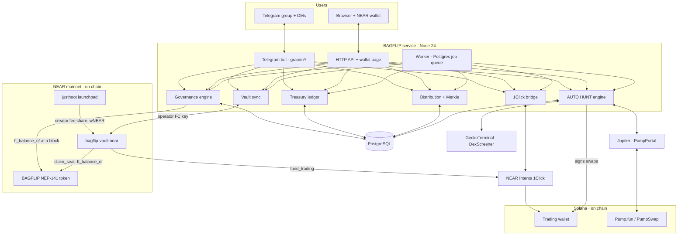
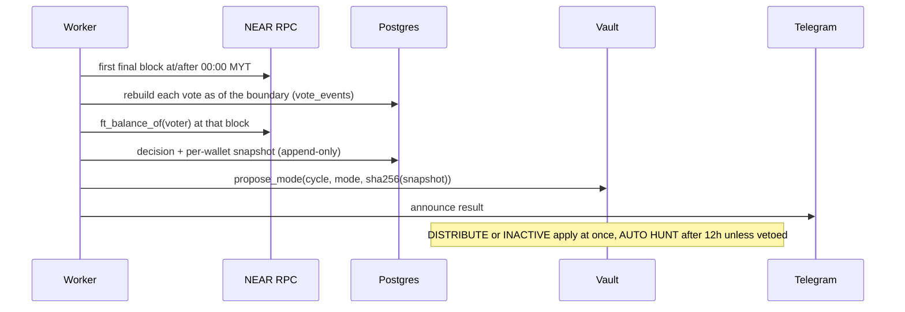

# Architecture

BAGFLIP is one Node 24 service (bot, HTTP API and worker in one process, `ROLE=all`), a PostgreSQL
database, and a Rust vault contract on NEAR. Trading runs on Solana; NEAR Intents connects the two.

## System diagram

## Components

| Component | Code | Responsibility |
|---|---|---|
| Configuration | `src/shared/config.ts` | Validated env; refuses unsafe live configurations at boot |
| Composition root | `src/app.ts` | Chooses simulated, paper or live adapters per `BAGFLIP_ENV` |
| Telegram bot | `src/bot/` | Commands, vote buttons, pinned governance message, outbox announcements |
| HTTP API | `src/api/server.ts` | `/connect` wallet page, `/api/challenge`, `/api/link`, `/public/*`, `/admin/*` |
| Wallet linking | `src/near/nep413.ts`, `src/governance/wallets.ts` | NEP-413 challenge, signature and full-access-key verification |
| Governance engine | `src/governance/engine.ts`, `cycle.ts` | Vote reconstruction, block snapshot, decision rules, daily cycle |
| Treasury ledger | `src/treasury/` | Double-entry journals, deposit detection, mode routing |
| Distribution | `src/distribution/` | Holder index, pro-rata entitlements, Merkle lists, claims, council seat sync |
| Vault client | `src/near/vault.ts` | `RpcVault` (live, signs with the operator key) and `SimVault` (same rules in memory) |
| Bridge | `src/bridge/` | 1Click quotes, deposits, status polling, transfer state machine |
| AUTO HUNT | `src/market/`, `src/strategy/`, `src/trading/`, `src/solana/` | Discovery, scoring, safety, execution, positions, P&L, reconciliation |
| Jobs | `src/jobs/`, `src/worker/` | Durable Postgres queue (`FOR UPDATE SKIP LOCKED`, leases, unique keys) |
| Vault contract | `contracts/vault/` | On-chain treasury rules and Holder Council |

## On-chain vs off-chain

| Concern | Where it lives | Verifiable by |
|---|---|---|
| Token balances (voting power, weights) | NEAR (BAGFLIP token) | `ft_balance_of` at the recorded block |
| Treasury funds and exit rules | NEAR (vault) | `get_status`, `get_config`, contract code hash |
| Daily mode | Decided off chain, mirrored on chain with a snapshot hash | `propose_mode` event; `/public/decisions/<cycle>` canonical JSON |
| Payout list | Computed off chain, root + total + data hash on chain | `/public/distributions/<id>`, `/public/proofs/<account>`, `claim` |
| Holder Council | NEAR (vault, balances checked by the contract) | `get_seats` |
| Bridge transfers | NEAR vault event + 1Click | `trading_fund_requested` event; 1Click `/v0/status` |
| Trades and positions | Solana transactions + off-chain ledger | Solana explorer for the trading wallet; `/public/ledger` |
| Votes and wallet links | Off chain (Postgres, append-only `vote_events`) | Decision snapshot rows |

## Custody boundaries

| Holder of funds | Controlled by | Limits |
|---|---|---|
| `bagflip-vault.near` | The contract's rules (the deployer key still exists; see [TREASURY.md](TREASURY.md)) | Claims and capped `fund_trading` only |
| `bagflip-bot.near` (operator) | The service | Function-call key: 9 vault methods, 0.25 NEAR gas allowance; holds no treasury funds |
| Solana trading wallet | The service (hot key, required to sign swaps) | Receives at most the vault's 50 NEAR / 24h cap |
| 1Click deposit address | NEAR Intents | Credited to the trading wallet only after `SUCCESS` + destination confirmation |

## Daily cycle

## Environments

| | development | paper | live |
|---|---|---|---|
| NEAR chain | simulated | real reads | real |
| Market data | simulated | real | real |
| Vault | `SimVault` | `SimVault` | contract (`LIVE_TRANSFERS_ENABLED`) |
| Trading | simulated | paper fills on real Jupiter quotes | real only with `LIVE_TRADING_ENABLED` + key |
| Database | PGlite | PGlite or Postgres | Postgres (required) |

The deployed service runs `live` with `LIVE_TRANSFERS_ENABLED=true` and `LIVE_TRADING_ENABLED=false`, so
vault operations are real and AUTO HUNT trades on paper books.

## Background jobs

| Job | Schedule |
|---|---|
| `governance.decide` / `governance.apply` | 00:00 MYT |
| `governance.tally` | every 5 min |
| `treasury.scan_deposits` | every 60 s |
| `vault.watch` (status cache, vetoes, unwrap) | every 60 s |
| `vault.sync_seats` (nominate top holders) | every 6 h |
| `vault.sync_mode`, `vault.propose_distribution`, `distribution.run`, `claim.pay` | on events |
| `bridge.fund_trading`, `bridge.poll`, `bridge.return` | on AUTO HUNT / wind-down |
| `trading.reconcile` | every 120 s |
| Hunt loop | scan every 30 s, positions every 15 s |

## Data model

| Group | Tables (* append-only) |
|---|---|
| Identity | `users`, `wallets`, `auth_challenges` |
| Governance | `votes`, `vote_events`*, `governance_decisions`*, `governance_snapshot_entries`* |
| Ledger | `ledger_journals`*, `ledger_entries`*, `treasury_deposits`, `unattributed_inflows` |
| Bridge | `bridge_transfers` |
| Trading | `trading_positions`, `trading_orders`, `chain_transactions`, `market_observations`, `scan_funnel`, `shadow_trades` |
| Distribution | `holder_index`, `distribution_events`*, `distribution_entitlements`*, `reward_claims`, `reward_claim_items`, `vault_distributions`, `vault_mode_syncs` |
| Operations | `jobs`, `notifications`, `system_state`, `admin_audit`* |

Migrations: `migrations/001_init.sql`, `002_vault.sql`, `003_funnel_shadow.sql`.
