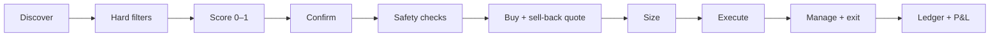

# AUTO HUNT: the Graduation Momentum engine

AUTO HUNT is the treasury's optional trading mode. When holders choose it and the vault's 12h time lock
has passed, capped amounts move to a Solana wallet, and the engine trades Pump.fun meme tokens without
anyone picking tokens by hand. It is a rules-based system (filters, a weighted score, risk checks, an exit
ladder), not a machine-learning model.

Code: `src/market/` (discovery, safety), `src/strategy/strategy.ts` (scoring, confirmation, exits, pure),
`src/trading/` (engine, evaluator, risk, positions, P&L, reconciliation), `src/solana/` (execution).
Every threshold below is the current source default; most are overridable by env (`.env.example`).

## Why "graduation momentum"

First-block sniping of new launches is dominated by co-located bots, and most launches dump within
minutes. BAGFLIP instead hunts tokens that have **already proven demand**:

* tokens close to completing the Pump.fun bonding curve, and
* fresh graduates that just migrated to PumpSwap,

when volume is accelerating, buyers dominate and the move is not yet vertical. The signal is visible in
public data, exits have liquidity, and it fits a 15–30 s polling loop.

## Pipeline

### A. Discovery (continuous)

| Source | What it provides |
|---|---|
| PumpPortal WebSocket | Every new Pump.fun token (`subscribeNewToken`) and every migration (`subscribeMigration`) |
| GeckoTerminal (polled each minute) | 5-minute trending pools, newest PumpSwap pools, most active Pump.fun curve pools |
| DexScreener | Token profiles and boosts; batched pair metrics for every watched mint |

Re-check cadence: fresh graduates every **10 s** for 30 minutes; curve tokens above ~$30k market cap every
**15 s**; new launches from 2 minutes old on a growing interval (dead launches are dropped).

### B. Momentum detection

Hard filters for the default **aggressive** variant (any one rejects): allowed venue (`pumpfun`, `pumpswap`,
`raydium`, `meteora`, `meteoradbc`, `raydium-launchlab`) quoted in SOL; age 3 min–96 h (0 min for fresh
graduates); market cap $12k–$25M; liquidity ≥ $6k (AMM); ≥ 60 trades/h and ≥ 6 per 5 min; 5-minute sells ≤ 1.6×
buys; 5m change > −3%; 1h change > −15%; 5m change ≤ +150% and 1h ≤ +2000%.

Then an explainable score:

| Component | Weight | Full marks when |
|---|---|---|
| Volume acceleration | 0.22 | 5m volume ≥ 4× the hour's average 5m pace |
| Buy pressure | 0.18 | ≥ 75% of 5m trades are buys |
| Short momentum | 0.15 | +15% in 5m (halved above +40%) |
| Activity | 0.15 | ~2,000 trades in 1h (log scale) |
| Hour trend | 0.10 | +100% in 1h |
| Depth | 0.10 | curve progress, or liquidity ≥ 15% of market cap |
| Lifecycle | 0.10 | fresh graduate 1.0, near curve completion 0.8, else 0.3 |

Entry needs score ≥ **0.52**. Confirmation: immediate at ≥ 0.68 or for a graduate ≤ 20 min old; otherwise a
second scan ≥ 8 s later with the price down no more than 6%.

### C. Risk screening

| Check | Rule |
|---|---|
| Mint / freeze authority | Must be revoked (never relaxed) |
| Token-2022 extensions | Rejects transfer fee, permanent delegate, transfer hook, non-transferable, default-frozen, pausable (never relaxed) |
| Holder concentration | Largest non-pool holder ≤ 20%, top-10 ≤ 50%, known creator ≤ 12% (skipped if the RPC won't report it) |
| Executable round trip | Real buy quote, then real sell quote for those tokens: price impact ≤ 6%, round-trip loss ≤ 15% (catches honeypots and thin pools) |
| Live transactions | Simulated before sending; settlement read from the confirmed transaction |

These checks remove whole classes of bad trades. They cannot remove market risk: prices can still collapse
between checks.

### D. Execution and position management

| Rule | Value |
|---|---|
| Position size | 25% of trading capital (`POSITION_SIZE_PERCENT`) |
| Max open positions | 4 (`MAX_CONCURRENT_POSITIONS`) |
| Minimum position | 0.05 SOL; deferred if fixed fees exceed 3% of size |
| Fee reserve | 0.01 SOL kept for network fees |
| Venues | Jupiter Swap V2 (`/order` + `/execute`), PumpPortal local transactions as fallback |
| Order safety | Signed and persisted before broadcast; a failed or expired transaction never books a trade |

Exits are triggered from the **executable sell quote** for the tokens held:

| Exit | Aggressive (default) | Original |
|---|---|---|
| Stop loss | −35% | −30% |
| Take profit | sell 40% at +60% | sell 50% at +80% |
| Trailing stop | −22% from peak after +30% | −25% after +40% |
| Momentum fade | after 2 h if P&L < +10% and 5m volume < 30% of entry | after 3 h |
| Crash | value −50% between checks → sell all, 50% slippage | same |
| Liquidity collapse | pool liquidity < 40% of entry → sell all | same |
| Max hold | 24 h | 24 h |
| Re-entry cooldown | 6 h after exit, 1 h after a failed entry | same |

New entries stop (open positions are still managed) when the mode is not AUTO HUNT or the vault is paused or
still time-locked, the emergency pause is on, `LIVE_TRADING_ENABLED` is false in live mode, there are 5
consecutive RPC failures, reconciliation fails, or an order is unresolved for over 10 minutes. On
DISTRIBUTE, positions are unwound with escalating slippage for up to 6 h, then written off.

### E. Performance reporting

* Every fill is a ledger journal: `trading:positions` (cost basis), `trading:available`, `pnl:realized`,
  `expense:fees`.
* **Realized P&L** comes only from settled sells and write-offs, net of fees. **Unrealized P&L** uses
  executable sell quotes and is labeled as such.
* Reconciliation compares on-chain SOL and token balances with the ledger every 120 s.
* `/trades`, `/pnl`, `/treasury` in Telegram; `/public/ledger` over HTTP.
* **Paper vs live:** paper fills use real Jupiter quotes plus 1.5% extra slippage and a 5% random failure
  rate. Shadow books (`SHADOW_VARIANTS`) run both variants on identical scans (`/experiment`, `/funnel`).
  Paper results are labeled and never mixed with the live ledger.

### F. Sample paper run

`node scripts/paper-compare.ts --minutes 10` on 2026-11-14 (live market data, 1 virtual SOL per variant):

| | aggressive | original |
|---|---|---|
| Discovered → scored → confirmed | 304 watched → 134 → 46 | 304 → 38 → 1 |
| Entries | 4 | 0 |
| Result after ~12 min | −19.9% (1 closed at a loss, 3 open) | 0% |

The run shows the pipeline working end to end on live data. It says nothing about profitability.

## Costs a trade must overcome

Measured on 2026-11-09: a Jupiter round trip on a Pump.fun curve token at 0.05 SOL cost **2.97%**. Network
fees are 5,000 lamports plus a 0.0001 SOL priority fee per transaction. Token-account rent (0.00204 SOL) is
recovered on close. 1Click quoted about 0.5% for 5 NEAR → SOL. A position needs roughly +4–6% to break
even, so the exit ladder targets asymmetric outcomes rather than a high win rate.

## Reproduce

* `node scripts/paper-scan.ts --minutes 3`: what the scanner sees (no DB, no orders).
* `node scripts/paper-compare.ts --minutes 10`: paper trading on live data, with funnel and report.
* `node scripts/replay.ts --since <date>`: replays recorded observations through the same rules.
