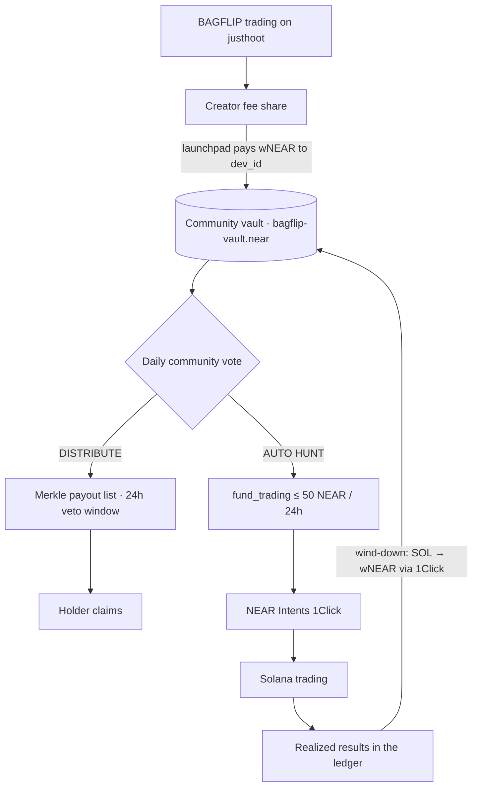

# Economic model and sustainability

BAGFLIP has one recurring revenue source: the creator fee share of BAGFLIP trading. Holders decide how
that revenue is used. The system makes no fixed payout commitment, so it is designed to work at any revenue
level, including zero.

## Economic flow

## A. Primary revenue: creator fees

State reported by the launchpad contract (`v2-launchpad.justhoot.near`, `get_token_fee_state` for
`bagflip.v2-launchpad.justhoot.near`):

| Field | Value | Meaning |
|---|---|---|
| `transfer_fee_pips` | 50,000 | 5% transfer fee on BAGFLIP transfers |
| `fee_pips` | 10,000 | 1% pool fee on the BAGFLIP/wNEAR pool |
| `shares.token_owner_bps` | 10,000 | The fee share the launchpad allocates to the token owner is 100% (burn 0%, holders 0%) |
| `dev_id` | `bagflip-vault.near` | Recipient of the creator share (handed over from `bagflip.near`) |
| `quote_token_id` | `wrap.near` | Payouts are in wNEAR |

How it reaches the vault: the launchpad accrues fees in BAGFLIP (`undistributed_token`), swaps them to wNEAR
in batches and pays the creator share to `dev_id`. The batch schedule is controlled by the launchpad, not by
BAGFLIP. On 2026-11-14 the launchpad showed 424,409 BAGFLIP of accrued fees awaiting its swap, and no payout
had reached the vault yet. The vault unwraps wNEAR to NEAR on request (`unwrap`). Only senders in
`DEPOSIT_ALLOWED_SENDERS` (the launchpad and the creator wallet) are credited as treasury revenue; anything else
is recorded as an unattributed inflow and never traded.

BAGFLIP does not receive the whole transfer fee or pool fee, only the creator share the launchpad pays out.

## B. Optional growth: AUTO HUNT

AUTO HUNT reallocates existing treasury capital to speculative trades. Gains, if any, are credited only
when settled (`pnl:realized`) and return to the vault when the mode switches back. Losses reduce trading
capital and may include the full allocated amount. Trading results are variable and are not treated as
revenue.

## C. Allocation rules

| Rule | Where enforced | Value |
|---|---|---|
| Mode choice | Governance engine + vault | Daily, token-weighted, strict majority |
| Trading budget | Vault (`fund_trading`) | ≤ 50 NEAR per rolling 24 h, AUTO HUNT mode only, after a 12 h time lock |
| Reserved funds | Vault (`reserved_for_claims`) | Funds in a payout list can never be traded |
| Contract reserve | Vault (`reserve`) | 0.05 NEAR kept for storage |
| Minimum transfer | Service | Bridge transfers ≥ $20 (`MIN_CROSS_CHAIN_TRANSFER_USD`) |
| Minimum distribution | Service | Pool ≥ $20 before a payout list (`MIN_DISTRIBUTION_POOL_USD`) |
| Distribution formula | Service + vault | `pool × holder balance ÷ eligible supply` at one block, rounded down; dust stays in the pool |
| Position sizing | Service | 25% of trading capital per position, max 4 |
| Fee reserves | Service | 0.5 NEAR and 0.01 SOL kept for network fees |

Holders who never linked a wallet are included in distributions; they can link later and claim. Unclaimed
amounts stay reserved.

## D. Sustainability design

* **No fixed obligation.** Payouts are a share of whatever is in the vault; nothing accrues as debt.
* **Variable revenue by design.** When trading slows, fees fall and the vault simply holds or distributes
  less. No mechanism mints, borrows or promises yield.
* **Community-directed capital.** Holders can stop trading at any time; DISTRIBUTE takes effect immediately.
* **Bounded exposure.** The daily cap limits how much can reach the trading wallet, and trades are deferred
  when fees would exceed 3% of the position.
* **Conditional trading.** No trade-frequency target exists: if nothing qualifies, nothing is bought.
* **Transparent accounting.** Every movement is a journal entry in integer units (yoctoNEAR, lamports),
  published at `/public/ledger`.

## E. Operating costs

| Cost | Paid from | Typical size |
|---|---|---|
| NEAR gas for vault calls (mode, seats, lists, claims) | Operator account `bagflip-bot.near` (team-funded) | Fractions of a cent per call; 0.25 NEAR key allowance |
| Vault storage | Vault reserve | 0.05 NEAR |
| NEAR Intents 1Click | Bridged amount (treasury) | ~0.5% quoted, plus 0.2% without a partner JWT |
| Solana network fees | Trading capital | 5,000 lamports + 0.0001 SOL priority fee per tx |
| Swap fees and slippage | Trading capital | 2.97% measured round trip on a curve token at 0.05 SOL |
| Hosting (Railway app + Postgres), RPC, Telegram | Team | Outside the treasury |

Infrastructure is team-funded today, so the treasury is not charged for hosting. Treasury-side costs
(bridge, swap, network fees) are journaled as `expense:fees` and reduce net results. At low revenue,
transfers wait for the $20 minimum so fixed fees stay small relative to amounts moved.

## F. Long-term direction

A reusable pattern for meme communities: route creator revenue to a rules-based vault, let holders decide
between paying out and reinvesting, and publish every step. Next steps are locking the vault, a
TEE-attested trading agent, and making the vault deployable for other tokens.
