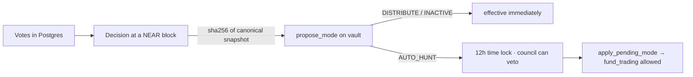

# Governance

Holders steer the treasury between **DISTRIBUTE** and **AUTO HUNT** from Telegram. The vote is computed
off chain from on-chain balances, then mirrored to the vault, which enforces delays and vetoes.

Code: `src/governance/engine.ts` (pure decision rules), `src/governance/cycle.ts` (daily cycle),
`src/governance/wallets.ts` (linking and votes), `contracts/vault/src/lib.rs` (enforcement).

## 1. Link a wallet (NEP-413)

1. In a DM, `/connect` returns a single-use link to the service's `/connect` page (opened in a browser).
2. The page asks the wallet (Meteor via NEAR Wallet Selector, or HOT / Intear via NEAR Connect) to sign a
   NEP-413 message. It contains the Telegram user id, a random 32-byte nonce and a 10-minute expiry, with
   recipient `NEP413_RECIPIENT`.
3. The backend verifies the signature, then checks on chain that the signing key is a **full-access key**
   of that account.
4. A NEAR account links to one Telegram user at a time; re-proving from another user moves the link and
   revokes the old vote.

No transaction is sent and no funds move. `/disconnect <account>` unlinks.

## 2. Vote

* The pinned group message has **💰 DISTRIBUTE** and **🔥 AUTO HUNT** buttons; `/vote` shows them anywhere.
* A vote applies to all of the user's linked wallets and **persists** until changed or unlinked.
* Every change is appended to `vote_events`; the current choice lives in `votes`.
* The live tally (refreshed every 5 minutes) is informational; only the daily decision counts.

## 3. Daily decision

At **00:00 Asia/Kuala_Lumpur** (`TIMEZONE`, `DAILY_DECISION_HOUR/MINUTE`):

1. Take the first final NEAR block at or after the boundary.
2. Rebuild every wallet's vote **as of the boundary** from `vote_events`. A vote cast after midnight counts
   for the next cycle.
3. Read each voting wallet's BAGFLIP balance **at that block**. Weight = balance, so moving tokens
   between wallets can't count them twice.
4. Apply the rules below, then store the decision and one snapshot row per wallet (both append-only).

| Rule | Value (default) |
|---|---|
| Start state | `INACTIVE` (no trading) |
| Switch | The other option needs **more than 50%** of valid weighted votes |
| Tie (exactly 50/50) or zero valid votes | Previous mode kept |
| First activation quorum | `VOTING_INITIAL_QUORUM_PERCENT` = 5% of eligible supply and `VOTING_MIN_DISTINCT_WALLETS` = 3 |
| Later switches | `VOTING_MIN_QUORUM_PERCENT` = 3% of eligible supply |
| Missed quorum | Previous mode kept |
| Eligible supply | Total supply − vault − token contract − `EXCLUDED_HOLDER_ACCOUNTS` (e.g. `dclv2.ref-labs.near`) |

Double triggers are no-ops (unique `cycle_id`, advisory lock), and a missed midnight is caught up after
downtime. Every decision is public at `/public/decisions/<cycle>`, including block height and hash, totals,
quorum, reason, config and the per-wallet snapshot.

## 4. From Telegram vote to on-chain action

A Telegram vote is not itself a treasury transaction. The chain of custody is:

* The vault records the snapshot hash, so anyone can check that the published snapshot matches what the
  operator proposed.
* The operator could propose a mode that differs from the published vote. That is detectable from the
  public snapshot, and the council can veto an AUTO HUNT activation during the 12h delay.

## 5. Holder Council

An on-chain council of top holders, managed by the vault itself (deployed values from `get_config`):

| Parameter | Deployed value |
|---|---|
| Seats | 20 (`seats_max`) |
| Minimum balance for a seat | 1 BAGFLIP (`min_seat_balance`) |
| Seat age before voting | 24 h (`seat_min_age`) |
| Veto a payout list or AUTO HUNT activation, or pause | 5 seats (`veto_threshold`) |
| Change operator / cap / exclusions, revoke an active list | 11 seats + 48 h delay (`admin_threshold`, `admin_delay`) |
| Unpause | 11 seats, no delay |
| Excluded from seats | `dclv2.ref-labs.near`, plus the vault, token and operator |

* **Seating:** anyone can call `claim_seat(candidate, replace)`. The vault reads `ft_balance_of` itself; a
  nominee takes a full council's seat only by holding more than that seat's current balance. The service
  nominates the current top holders every 6 hours.
* **Scaling:** thresholds scale down to the number of eligible seats (minimum 1), so the vault cannot
  deadlock. With 2 seats filled and none older than 24 h, 1 vote is currently required.
* **Limits:** council members cannot withdraw, pay themselves or change code; the contract has no such
  method.

## 6. Concentration and emergency controls

* **Concentration.** Voting power follows holdings, so large holders weigh more by design. The creator
  wallet `bagflip.near` holds BAGFLIP and may vote and hold a seat. The launchpad account currently holds a
  seat (it accumulates fee tokens) but cannot vote with it. An 11-seat admin action can extend the
  exclusion list.
* **Emergency.** The operator or 5 council seats can `pause` the vault, which blocks claims and trading
  transfers. Off chain, `/pause` (admin), `POST /admin/pause` or `EMERGENCY_PAUSE=true` stops new trades
  while open positions continue to be managed.
