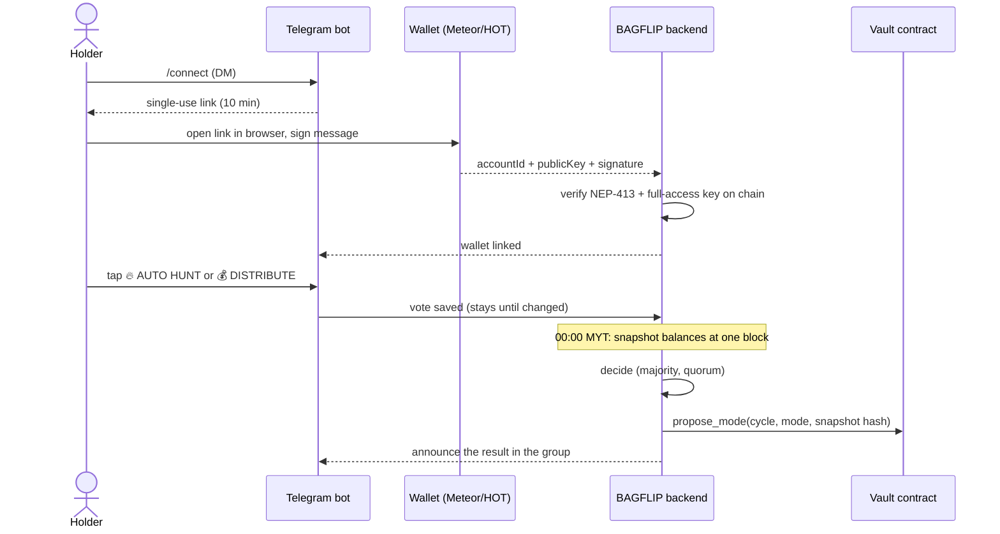
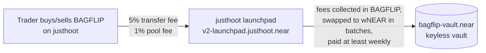
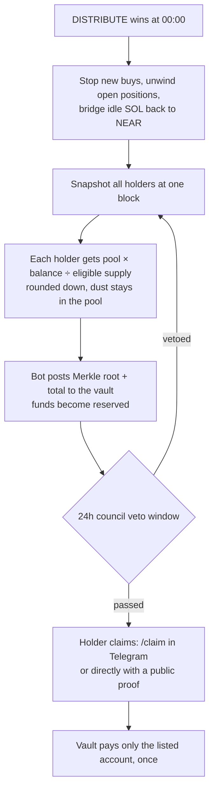
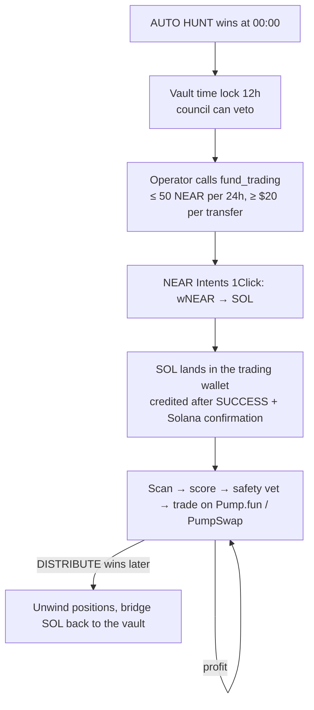
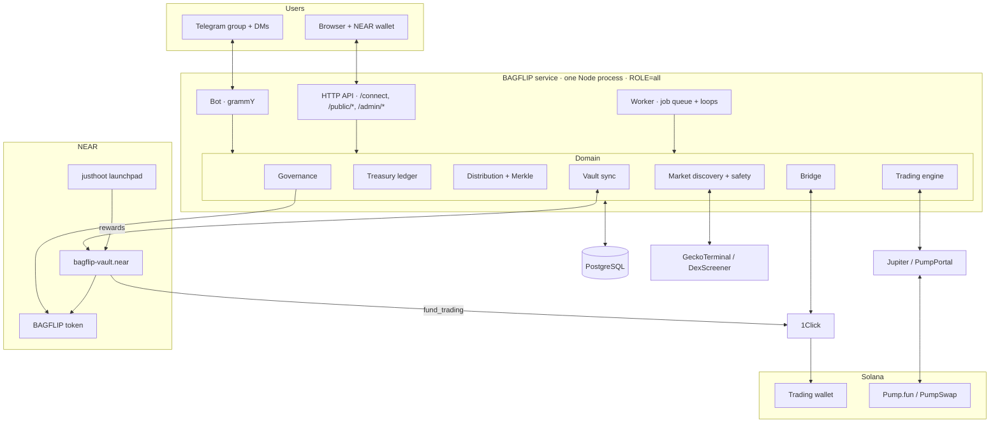

# BAGFLIP: system scope and design

> **Take the reward, or flip the bag.**
> A Telegram-first meme treasury. Creator-fee rewards from the BAGFLIP token on NEAR go into a
> keyless vault contract. Every day, holders decide by weighted vote whether the rewards are
> **DISTRIBUTED** to them or used to **AUTO HUNT**: autonomous meme-token trading on Solana.

| | |
|---|---|
| Document date | 2026-11-14 |
| Purpose | Hackathon submission and demo (fewer than 10 users) |
| Repository | `bagflipmeme/bagflip` |
| Live app | `https://bagflip-production.up.railway.app` (Railway, `BAGFLIP_ENV=live`) |
| Telegram | bot `@bagflip_bot`, group `-1004404598029` |

---

## Contents

1. [Scope summary](#1-scope-summary)
2. [What has been built](#2-what-has-been-built)
3. [System features](#3-system-features)
4. [How it works: user journey](#4-how-it-works-user-journey)
5. [Cash flow](#5-cash-flow)
6. [System requirements](#6-system-requirements)
7. [System design](#7-system-design)
8. [Current deployment](#8-current-deployment)
9. [Status, limits and roadmap](#9-status-limits-and-roadmap)

---

## 1. Scope summary

### 1.1 Problem

Meme-token creator fees usually go to one wallet that the creator controls. Holders have to trust
that the creator will share or use the money well, and they get no say.

### 1.2 Solution

BAGFLIP puts the fees in a smart contract that **nobody can withdraw from**. Holders steer it from
Telegram:

- **💰 DISTRIBUTE:** the rewards are split pro-rata by BAGFLIP balance, and holders claim them.
- **🔥 AUTO HUNT:** a bot bridges a capped amount to Solana and trades Pump.fun tokens. Profits
  recycle; losses can reach zero.

### 1.3 In scope

- Telegram bot: voting, status, treasury, trades, claims and admin tools.
- NEAR wallet verification (NEP-413 signed message, no keys or seed phrases).
- Continuous, balance-weighted voting with a daily decision at **00:00 Asia/Kuala_Lumpur**.
- The keyless **vault contract** (Rust) with an on-chain **Holder Council** of the top 20 holders.
- A double-entry treasury ledger and deposit detection.
- Distribution with Merkle payout lists and claims.
- A NEAR → Solana bridge via **NEAR Intents 1Click**.
- A Solana trading engine (Graduation Momentum strategy) with paper and live execution.
- Strategy reporting: scanner funnel and paper A/B comparison.
- Public audit endpoints, Docker image, Railway deployment, tests and docs.

### 1.4 Out of scope

- A web dashboard (Telegram is the only interface, plus one wallet-signing page).
- Token launch and the launchpad itself (justhoot provides them).
- Legal and compliance work (demo only).
- TEE-hosted trading keys (on the roadmap).

---

## 2. What has been built

| Deliverable | Where | State |
|---|---|---|
| Backend service (bot + API + worker in one process) | `src/` | Running live on Railway |
| Vault smart contract | `contracts/vault/` (Rust, near-sdk 5.30.1) | Deployed on mainnet at `bagflip-vault.near` |
| Database schema | `migrations/001–003` | Applied on Railway Postgres |
| Wallet-signing page | `src/api/connect-page.ts` | Live at `/connect` |
| Trading strategy (2 variants) | `src/strategy/`, `src/trading/` | Running in paper mode on live market data |
| Bridge integration | `src/bridge/` | Built, verified with real quotes |
| Operator scripts | `scripts/` (vault plan, paper compare, live checks, replay, …) | Done |
| Tests | 77 TypeScript + 17 Rust | All passing |
| Docker image | `Dockerfile` | Used by Railway |
| Docs | `README.md`, `docs/` | This file, overview, vault, strategy, security |

---

## 3. System features

### 3.1 Holder features (Telegram)

| Command | What it does |
|---|---|
| `/start`, `/help` | Introduction and command list |
| `/connect` *(DM)* | Sends a single-use link that opens in the browser to verify a NEAR wallet |
| `/disconnect <account>` *(DM)* | Unlinks a wallet |
| `/vote` | Shows the **💰 DISTRIBUTE / 🔥 AUTO HUNT** buttons |
| `/power` *(DM)* | Your voting weight and wallets |
| `/status` | Current mode, live tally, time to next decision |
| `/treasury` | Vault balance, reserved vs. free, trading capital |
| `/trades`, `/pnl` | Open/closed positions, realized and unrealized P&L |
| `/claim` *(DM)* | Claim your distribution (the bot relays it to the vault) |
| `/council` | Holder Council seats and thresholds |
| `/whoami`, `/disclosures` | Your identity link; the risk disclosures |

### 3.2 Admin features

`/pause`, `/resume`, `/deposit <tx>`, `/post_governance`, `/admin`, `/funnel`, `/experiment`.
Admins are an allow-list of Telegram IDs, and every admin action is written to an append-only audit
table.

### 3.3 Group features

- One **pinned governance message** with vote buttons, updated in place.
- Announcements: deposits, decisions, mode changes, trades opened/closed, claimable rewards,
  failures and pauses.

### 3.4 Governance features

- Wallet linking with NEP-413 signatures (Meteor, HOT, Intear, …), plus a check that the signing
  key is a full-access key of the account on chain.
- **Continuous votes:** a vote stays until changed, revoked or unlinked.
- **Weight** = BAGFLIP balance at one NEAR block, taken at the decision time.
- **Rules:** strict majority (>50%) to switch; a tie or no votes keeps the mode; quorum applies;
  the system starts INACTIVE.
- **Audit:** each decision and its per-wallet snapshot are public, and its sha256 is written to the
  vault.

### 3.5 Vault features (on chain)

- No owner, no withdraw, no upgrade methods. Funds leave only by **claims** or **capped trading
  funding**.
- AUTO HUNT activation is time-locked **12h**; payout lists have a **24h** veto window; admin changes
  wait **48h**.
- AUTO HUNT funding is capped at **50 NEAR per rolling 24h**.
- **Holder Council:** top-20 holders take seats on chain (balances read by the contract); they can
  veto, pause and approve admin changes. They can never withdraw.
- The operator (bot) can pause, but can't move money outside the rules.

### 3.6 Trading features

- Continuous discovery: PumpPortal WebSocket, GeckoTerminal and DexScreener.
- **Graduation Momentum** scoring (0–1) with two variants, **aggressive** (default) and original.
- Safety checks that are never relaxed: no mint/freeze authority, no risky Token-2022 extensions, a
  real sell-back quote must exist, and every live transaction is simulated before sending.
- Up to **4 positions × 25%** of trading capital; stop loss, take profit, trailing stop, stale exit,
  crash exit, 24h max hold. **No forced trades.**
- Execution through **Jupiter Swap V2**, with **PumpPortal** as a fallback.
- **Shadow books** compare both variants on identical scans; a **scanner funnel** shows where tokens
  drop out.

### 3.7 Operations features

- Durable Postgres job queue (leases, retries, unique keys), so a double trigger makes one decision.
- Restart recovery: missed decisions, in-flight bridge transfers and submitted orders are resumed.
- Reconciliation between chain balances and the ledger; any shortfall pauses trading.
- Rate limits per user and per IP, secret redaction in logs, and a boot-time refusal of unsafe
  configurations.

---

## 4. How it works: user journey

**The daily cycle:**

1. **All day:** votes accepted, deposits detected, the live tally and pinned message refreshed,
   positions managed.
2. **00:00 MYT:**
   1. take the first final NEAR block at or after midnight;
   2. rebuild every vote as of midnight from the append-only vote log;
   3. read every voting wallet's balance at that block;
   4. decide and store the decision with its snapshot (immutable);
   5. announce it in Telegram and mirror it to the vault.
3. **After the decision:** the treasury is routed for the new mode.

---

## 5. Cash flow

### 5.1 Where the money comes from

- Each BAGFLIP trade pays the launchpad's fees. The creator share is **100%** (`token_owner_bps
  10000`); the holder and burn shares are 0.
- The launchpad first collects fees **in BAGFLIP**, then its batch job swaps them to **wNEAR** and
  pays the fee recipient. That recipient (`dev_id`) is now **`bagflip-vault.near`**, so rewards go
  straight into the vault.
- Check pending rewards with the launchpad's `get_token_fee_state` (`undistributed_token`,
  `dev_owed`). At the time of writing, 424,409 BAGFLIP of fees were waiting for the swap and the
  vault held 0 wNEAR.

### 5.2 Inside the vault

| Bucket | Meaning |
|---|---|
| `free_balance` | Unreserved funds: can be reserved for a payout list or, in AUTO HUNT, sent to trading |
| `reserved_for_claims` | Locked for an active payout list; can only go to the listed holders |
| Storage reserve | A small amount kept so the contract account stays usable |

The vault unwraps wNEAR to NEAR when the operator calls `unwrap`.

### 5.3 DISTRIBUTE flow

- Unregistered holders are included; they can connect and claim later. Unclaimed rewards stay
  reserved.
- Amounts below **$20** keep accumulating so fees stay small.

### 5.4 AUTO HUNT flow

### 5.5 Fees and costs paid by the system

| Cost | Paid by | Size |
|---|---|---|
| NEAR gas for vault calls (mode, seats, payout lists, claims) | `bagflip-bot.near` (operator key, 0.25 NEAR allowance) | Fractions of a cent per call |
| 1Click bridge fee + spread | Bridged amount | Shown in each quote; transfers batched to ≥ $20 |
| Solana fees + priority fees | Trading wallet | A trade is skipped if fees would exceed 3% of it |
| Swap slippage / price impact | Trading capital | Limited by the variant's round-trip-cost and price-impact limits |

### 5.6 Accounting

Every movement is a journal in an **append-only double-entry ledger** (integer yoctoNEAR and
lamports; no floating point). Main accounts:

- **NEAR:** `treasury:available`, `distribution:pool`, `distribution:claimable`, `bridge:outbound`,
  `equity:deposits`, `equity:distributed`
- **SOL:** `trading:available`, `trading:positions`, `bridge:inbound`, `pnl:realized`
- **Both:** `expense:fees`

Deposits count only from known senders (the creator wallet or the launchpad), once per on-chain
receipt. Anything else is an "unattributed inflow" and is never traded.

---

## 6. System requirements

### 6.1 Functional requirements

| ID | Requirement |
|---|---|
| FR-1 | A user links a NEAR wallet by signing a single-use message; no keys are ever entered |
| FR-2 | One NEAR account links to one Telegram user; tokens are counted once |
| FR-3 | Votes persist until changed; weight is the balance at the decision block |
| FR-4 | A decision runs exactly once per day at 00:00 MYT, including after downtime |
| FR-5 | Mode changes need >50% of weighted votes and quorum; ties keep the mode |
| FR-6 | Decisions and snapshots are immutable and public |
| FR-7 | The vault pays holders only through Merkle-proven claims, once each |
| FR-8 | Trading funding is time-locked, capped and only allowed in AUTO HUNT |
| FR-9 | The Holder Council can veto payout lists and AUTO HUNT, and pause the vault |
| FR-10 | Trading only enters tokens that pass the safety checks and have a sell-back quote |
| FR-11 | Switching to DISTRIBUTE unwinds positions and brings SOL back |
| FR-12 | All trades, P&L and treasury figures are visible in Telegram |

### 6.2 Non-functional requirements

| Area | Requirement |
|---|---|
| Safety | No money moves unless `BAGFLIP_ENV=live` **and** the matching `LIVE_*` flag is on; boot refuses unsafe configs |
| Correctness | Integer money math; idempotent jobs; orders signed and saved before sending |
| Reliability | Durable job queue; restart recovery; one worker process |
| Transparency | Public JSON endpoints; on-chain events for every vault action |
| Security | Function-call-only operator key; no treasury key; rate limits; secret redaction |
| Scale | Demo: < 10 users, one Railway instance |

### 6.3 Runtime and software

| Item | Version / choice |
|---|---|
| Runtime | **Node.js ≥ 24** (runs TypeScript directly via type stripping; no build step) |
| Package manager | pnpm 10 |
| Database | **PostgreSQL** (17 tested) in live; PGlite for tests and local dev |
| Telegram | grammY 1.46 |
| NEAR | `@near-js/*` 2.5.1 |
| Solana | `@solana/web3.js` 1.98.4 |
| Validation | zod 4 |
| Tests | vitest 5 (TS), `cargo test` (Rust) |
| Contract build | Rust + near-sdk 5.30.1 (Docker image `contracts/vault/Dockerfile.build`) |

### 6.4 Accounts and keys

| Account | Chain | Purpose | Key held by |
|---|---|---|---|
| `bagflip.near` | NEAR | Creator wallet, large holder, council seat | Owner |
| `bagflip-vault.near` | NEAR | The vault contract | Owner (full-access key **still present**, not locked) |
| `bagflip-bot.near` | NEAR | Operator: calls vault methods | Railway (`OPERATOR_PRIVATE_KEY`, function-call key) |
| `EwMZcvgdnZRuQxzz66bq86EYSpgLcA4ppW6eEAut8FuQ` | Solana | Trading wallet | Not configured yet (paper trading) |

### 6.5 External services

| Service | Used for | Key needed |
|---|---|---|
| Telegram Bot API | The bot | Bot token |
| NEAR RPC (FastNEAR) | Balances, blocks, vault calls | No (paid RPC recommended) |
| NEAR Intents 1Click | Bridging | No (partner key optional) |
| Jupiter Swap V2 | Quotes and swaps | No (key optional) |
| PumpPortal | New-token stream, fallback trades | No |
| GeckoTerminal, DexScreener | Market discovery | No |
| Solana RPC | Safety checks, settlement | No (paid RPC recommended) |

### 6.6 Hosting

- Any Docker host with a public HTTPS URL and PostgreSQL. Used: **Railway** (app + Postgres).
- Static hosts (Cloudflare Pages and similar) can't run it: it needs a long-running process.
- Resources for the demo: one small instance (about 512 MB RAM) and one small Postgres.

---

## 7. System design

### 7.1 Architecture

### 7.2 Components

| Module | Path | Responsibility |
|---|---|---|
| Config | `src/shared/config.ts` | Env validation, safety rules for live mode |
| Composition root | `src/app.ts` | Builds real or simulated adapters per environment |
| Governance | `src/governance/` | Wallet links (NEP-413), votes, tally, daily decision (pure engine) |
| Treasury | `src/treasury/` | Ledger, deposit scanning, routing, prices |
| NEAR | `src/near/` | RPC, signer, NEP-413, `RpcVault` (live) and `SimVault` (same rules in memory) |
| Distribution | `src/distribution/` | Holder index, pro-rata, Merkle lists, vault sync, seat sync, claims |
| Bridge | `src/bridge/` | 1Click client, depositors, transfer state machine |
| Market | `src/market/` | Discovery and on-chain safety checks |
| Strategy | `src/strategy/` | Variants, scoring, confirmation, exits |
| Trading | `src/trading/` | Engine, evaluator, funnel, shadow books, positions, risk, P&L, reconcile |
| Solana | `src/solana/` | RPC, settlement parsing, live/paper/simulated execution |
| Bot / API | `src/bot/`, `src/api/` | Telegram handlers and views; HTTP server and wallet page |
| Worker | `src/worker/` | Job handlers and recurring loops |
| Vault contract | `contracts/vault/` | On-chain rules, council, claims |

### 7.3 Background jobs

| Job | Schedule | Does |
|---|---|---|
| `treasury.scan_deposits` | every 60s | Detects incoming rewards, credits the ledger |
| `governance.tally` | every 5 min | Live tally for the pinned message |
| `governance.decide` / `governance.apply` | 00:00 MYT | Snapshot, decision, apply mode |
| `vault.sync_mode` | after each decision | `propose_mode` on the vault |
| `vault.watch` | every 60s | Caches vault status, detects vetoes, unwraps wNEAR |
| `vault.sync_seats` | every 6h | Nominates the top holders for council seats |
| `treasury.route` / `route_periodic` | on events / hourly | Reserves for distribution or funds trading |
| `distribution.run`, `vault.propose_distribution` | on DISTRIBUTE | Builds and posts payout lists |
| `claim.pay` | on `/claim` | Relays claims to the vault |
| `bridge.fund_trading`, `bridge.poll`, `bridge.return` | on AUTO HUNT / unwind | 1Click transfers both ways |
| `trading.reconcile` | interval | Chain vs. ledger check; pauses on shortfall |
| Hunt loop | every 10–30s | Scan, score, enter, manage positions |

Jobs live in Postgres (`FOR UPDATE SKIP LOCKED`, leases, retries, unique keys), so a crash or a
double trigger never repeats a payment or a decision.

### 7.4 State machines

- **Mode:** `INACTIVE → AUTO_HUNT ⇄ DISTRIBUTE` (and back to INACTIVE if paused or out of quorum
  rules). In the vault, AUTO HUNT becomes effective only after the 12h time lock.
- **Bridge transfer:** `quoted → submitting → deposited → processing → success | refunded | failed`.
  Credit only on success plus destination confirmation.
- **Order:** `signed (saved) → sent → confirmed | failed | expired`. Only confirmed orders book a
  trade.
- **Payout list:** `proposed → (24h) active → claimed…` or `vetoed → rebuilt`.

### 7.5 Data model

| Group | Tables |
|---|---|
| Identity | `users`, `wallets`, `auth_challenges` |
| Governance | `votes`, `vote_events`*, `governance_decisions`*, `governance_snapshot_entries`* |
| Accounting | `ledger_journals`*, `ledger_entries`*, `treasury_deposits`, `unattributed_inflows` |
| Bridge | `bridge_transfers` |
| Trading | `trading_positions`, `trading_orders`, `chain_transactions`, `market_observations` |
| Distribution | `holder_index`, `distribution_events`*, `distribution_entitlements`*, `reward_claims`, `reward_claim_items` |
| Vault mirror | `vault_distributions`, `vault_mode_syncs` |
| Reporting | `scan_funnel`, `shadow_trades` |
| Infrastructure | `jobs`, `notifications`, `system_state`, `admin_audit`* |

\* append-only

### 7.6 Vault contract design

- **Claims:** Merkle leaf `sha256(0x00 ‖ epoch u64 LE ‖ amount u128 LE ‖ account_id)`, node
  `sha256(0x01 ‖ min ‖ max)`. Same code and test vectors in Rust and TypeScript.
- **Operator methods** (function-call key on `bagflip-bot.near`): `propose_mode`,
  `propose_distribution`, `fund_trading`, `claim_many`, `claim`, `claim_seat`, `unwrap`,
  `apply_pending_mode`, `pause`.
- **Council:** `claim_seat` contests decided by the contract's own `ft_balance_of` calls; a seat
  votes only after 24h; thresholds scale down to the number of eligible seats so it never
  deadlocks.
- **Risk asymmetry:** going safer (DISTRIBUTE, INACTIVE, pause, veto) is immediate; going riskier
  (AUTO HUNT, new payout list, admin change) waits.
- **Code hash:** `5HBEhQYPoyHkaBnWXDpyRTrcUnxMiCbKmd6LfBvi48D7`.

### 7.7 Trust model

| Party | Can | Can't |
|---|---|---|
| Vault contract | Hold funds, enforce rules | Be upgraded or drained (once locked) |
| Bot / operator | Propose modes, payout lists, fund trading within the cap, pause | Withdraw, exceed the cap, skip time locks or veto windows |
| Holder Council | Veto, pause, approve admin changes | Withdraw or pay themselves |
| Owner (today) | Still holds the vault's full-access key | — the vault isn't locked yet (demo choice) |

What the contract can't verify, and how it's bounded: the off-chain snapshot (public + 24h veto),
the Solana destination of a bridge deposit (cap + logs + pause), and the hot Solana trading key
(cap).

### 7.8 Environments

| | development | paper | live |
|---|---|---|---|
| NEAR | simulated | real reads | real |
| Market data | simulated | real | real |
| Vault | `SimVault` | `SimVault` | real contract (`LIVE_TRANSFERS_ENABLED`) |
| Trading | simulated | paper fills on real quotes | real only with `LIVE_TRADING_ENABLED` + Solana key |

### 7.9 Public interfaces

| Endpoint | Returns |
|---|---|
| `GET /health` | Service status, environment, mode |
| `GET /connect?c=…` | Wallet-signing page |
| `GET /api/challenge/:id`, `POST /api/link` | NEP-413 challenge and verification |
| `GET /public/vault` | Vault status, council seats, payout lists, mode syncs |
| `GET /public/decisions[/:cycle]` | Decisions with snapshots and the hashed canonical JSON |
| `GET /public/ledger` | Ledger journals |
| `GET /public/distributions/:id`, `/public/proofs/:account` | Payout lists and claim proofs |
| `GET /admin/funnel`, `/admin/experiment` | Strategy reports (admin) |

---

## 8. Current deployment

| Item | State on 2026-11-14 |
|---|---|
| Railway app | Online, `BAGFLIP_ENV=live`, `LIVE_TRANSFERS_ENABLED=true`, `LIVE_TRADING_ENABLED=false` |
| Database | Railway PostgreSQL |
| Vault | `bagflip-vault.near` deployed and verified; about 0.28 NEAR free; mode INACTIVE; not paused |
| Council | 2 seats filled on chain (`bagflip.near`, `v2-launchpad.justhoot.near`); eligible after 24h |
| Reward handover | Done: launchpad `dev_id` = `bagflip-vault.near` |
| Rewards received | 0 wNEAR so far; first batch payout from justhoot pending |
| Operator | `bagflip-bot.near` with function-call keys limited to the vault |
| Trading | Paper mode on live data (aggressive + original shadow) |
| Tests | 77 TS + 17 Rust passing |

---

## 9. Status, limits and roadmap

### 9.1 Done

Governance, wallet linking, daily decisions, ledger, deposits, vault contract and council, vault
sync on mainnet, distribution and claims, bridge workflow, discovery, strategy variants, funnel,
shadow comparison, paper execution, Telegram bot, API, Docker, Railway deployment and docs.

### 9.2 Not yet exercised with real money

- The first justhoot payout into the vault, and a real payout list and claim.
- Real 1Click deposits from the vault.
- Live Solana trading (needs `SOLANA_TRADING_PRIVATE_KEY` and SOL for fees).
- Locking the vault (deleting its keys) — intentionally skipped for the demo so funds stay
  recoverable.

### 9.3 Known limits

- Polling every 10–30s: the engine can't react inside a single block.
- Free RPCs rate-limit big snapshots and holder-concentration checks.
- Holder discovery depends on FastNEAR's event history.
- Trading can lose 100% of the trading capital. Paper results aren't live results.
- The launchpad contract holds fee tokens and can take a council seat; it can't vote with it.

### 9.4 Roadmap

1. Confirm the first reward payout and run a full DISTRIBUTE cycle with claims.
2. Enable live trading with a small capital and a dedicated Solana key.
3. Move the Solana trading key into a TEE agent.
4. Exclude the launchpad contract from council seats (council admin proposal).
5. Lock the vault and publish the proof (zero access keys + code hash).
6. Paid RPCs for NEAR and Solana.
